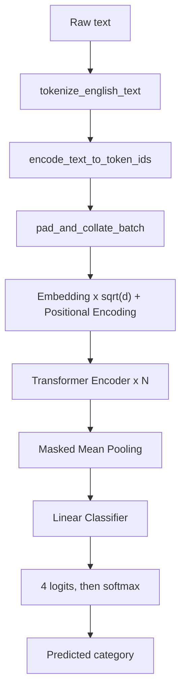

# Transformer Encoder News Classifier

A complete, from-scratch **PyTorch** project that classifies English news text into one of four topics using a **Transformer Encoder**. It trains on the public **AG News** dataset and ships as a single readable Python file, [`main.py`](main.py), with one `main()` entry point.

The model reads a headline or short article and predicts one of:

| Label index | Category   | Typical content                          |
| :---------: | :--------- | :--------------------------------------- |
| 0           | `World`    | International news, politics, conflicts  |
| 1           | `Sports`   | Matches, athletes, tournaments           |
| 2           | `Business` | Companies, markets, economy              |
| 3           | `Sci/Tech` | Science, technology, space, the internet |

> No pretrained language model is used. Every weight, including the word embeddings, is learned from the training data.

---

## Table of Contents

1. [At a Glance](#1-at-a-glance)
2. [Background: Key Concepts](#2-background-key-concepts)
3. [Project Layout](#3-project-layout)
4. [Installation](#4-installation)
5. [Quick Start](#5-quick-start)
6. [Command-Line Reference](#6-command-line-reference)
7. [How the Pipeline Works, Step by Step](#7-how-the-pipeline-works-step-by-step)
8. [Code Map of `main.py`](#8-code-map-of-mainpy)
9. [Generated Files](#9-generated-files)
10. [Results of the Included Run](#10-results-of-the-included-run)
11. [Tuning and Improving the Model](#11-tuning-and-improving-the-model)
12. [Troubleshooting](#12-troubleshooting)
13. [Limitations](#13-limitations)
14. [Legacy Multi-File Version](#14-legacy-multi-file-version)
15. [Glossary](#15-glossary)

---

## 1. At a Glance

| Item                  | Value                                                                   |
| :-------------------- | :---------------------------------------------------------------------- |
| Task                  | Single-label text classification (4 classes)                            |
| Dataset               | AG News (`fancyzhx/ag_news` on the Hugging Face Hub)                    |
| Model                 | Embedding + Sinusoidal Positional Encoding + 2-layer Transformer Encoder + masked mean pooling + linear classifier |
| Trainable parameters  | 2,907,704 (about 2.9 million) for a 26,647-word vocabulary              |
| Optimizer / Loss      | AdamW / Cross-Entropy                                                   |
| Framework             | PyTorch                                                                 |
| Code style            | Functions only. No custom classes, no nested functions                  |
| Included run          | 11,400 training rows, 20 epochs, **82.3% test accuracy** in about 0.5 minutes on a GPU |

---

## 2. Background: Key Concepts

If you are new to this area, this section gives the vocabulary needed to read the rest of the document.

**Text classification.** Given a piece of text, predict which category it belongs to. Here the input is a news headline plus a short description, and the output is one of four labels.

**Why text must become numbers.** Neural networks only operate on numbers. The pipeline therefore converts text to a sequence of integers (token IDs), then to vectors (embeddings), and finally to four scores (one per category).

**Transformer.** A neural network architecture built around *self-attention*. In self-attention, every word looks at every other word in the sentence and decides how much to pay attention to each one. This lets the model understand context. For example, the word "bank" is interpreted differently next to "river" than next to "loan".

**Encoder.** The half of the Transformer that *reads and understands* input. (The decoder half generates output text.) A classifier only needs to understand text, so an encoder alone is enough.

**Positional encoding.** Self-attention processes all words in parallel and has no built-in sense of word order. Positional encoding adds a position-dependent signal to each word vector so the model can tell "dog bites man" from "man bites dog".

**Padding and masking.** Sentences in a batch have different lengths, but tensors must be rectangular. Short sentences are padded with a dummy `<pad>` token. A *mask* tells the model to ignore those dummy positions.

**Training vs. validation vs. test.**
- *Training set*: the model learns from it.
- *Validation set*: used during training to monitor generalization and to pick the best epoch.
- *Test set*: touched only once at the end, to report an honest final score.

---

## 3. Project Layout

```
transformer_news_classifier/
|-- main.py                     # The complete project in one file (use this)
|-- requirements.txt            # Python dependencies
|-- requirements-smoke-test.txt # Minimal dependencies for the model-only smoke test
|-- README.md                   # This document
|-- .gitignore
|-- checkpoints/
|   `-- best_model.pt           # Created by training (best validation accuracy)
|-- results/
|   |-- training_curves.png     # Loss and accuracy plots
|   |-- history.json            # Per-epoch metrics
|   `-- final_metrics.json      # Final test metrics
`-- (legacy multi-file version, see section 14)
    |-- data_utils.py
    |-- model.py
    |-- train.py
    |-- predict.py
    `-- smoke_test.py
```

[`main.py`](main.py) is the maintained, recommended entry point. The five legacy files are the original multi-file, class-based implementation and are kept for reference.

---

## 4. Installation

**Requirements**
- Python 3.10 or newer (developed and tested on Python 3.11).
- Internet access on the first training run, to download AG News from the Hugging Face Hub. It is cached locally afterwards.
- A CUDA-capable NVIDIA GPU is optional. The project runs on CPU too, only more slowly.

**Steps (Windows)**

```bash
python -m venv .venv
```

Activate the environment:

```bat
:: Windows CMD
.venv\Scripts\activate.bat
```

```powershell
# PowerShell
.venv\Scripts\Activate.ps1
```

Install the dependencies:

```bash
python -m pip install --upgrade pip
pip install -r requirements.txt
```

**What each dependency is for**

| Package      | Why it is needed                                                     |
| :----------- | :------------------------------------------------------------------- |
| `torch`      | Tensors, neural-network layers, autograd, optimizers, DataLoader     |
| `datasets`   | Downloads and caches AG News (pinned to `>=3.0.0,<4.0.0`)            |
| `pyarrow`    | Storage backend of `datasets` (pinned to `<18`, see [Troubleshooting](#12-troubleshooting)) |
| `matplotlib` | Draws the training curves                                            |
| `numpy`      | Random seeding                                                       |

**GPU note.** To train on an NVIDIA GPU, install a PyTorch build that matches your CUDA version (see the selector on pytorch.org). Verify with:

```bash
python -c "import torch; print(torch.cuda.is_available())"
```

If this prints `False`, the project still works, but on CPU.

---

## 5. Quick Start

**1. Verify the model without downloading anything (takes seconds):**

```bash
python main.py --mode test
```

Expected output: `Smoke test passed successfully.` with input shape `(4, 12)` and output shape `(4, 4)`.

**2. Train:**

```bash
python main.py --mode train
```

This uses the defaults: 12,000 training rows, 2,000 test rows, 20 epochs.

**3. Classify new text:**

```bash
python main.py --text "Scientists discover new water traces on Mars."
```

Example output:

```
--- Prediction Result ---
Text: "Scientists discover new water traces on Mars."
Predicted Category: [Sci/Tech]
Class Probabilities:
  Sci/Tech  : 94.00%  [=======================]
  Business  :  5.46%  [=]
  World     :  0.52%  []
  Sports    :  0.01%  []
-------------------------
```

Or run interactively, which prompts for the text:

```bash
python main.py --mode predict
```

---

## 6. Command-Line Reference

All options are defined in `parse_command_line_arguments()`.

**Mode and inference**

| Option         | Default                       | Description                                                                 |
| :------------- | :---------------------------- | :-------------------------------------------------------------------------- |
| `--mode`       | `train`                       | `train` runs the full training pipeline, `predict` classifies text, `test` runs the smoke test |
| `--text`       | none                          | Text to classify. Passing it while mode is `train` switches to `predict` automatically |
| `--checkpoint` | `checkpoints/best_model.pt`   | Checkpoint file to load for prediction                                      |

**Training and model hyperparameters**

| Option                | Default | Description                                                          |
| :-------------------- | :-----: | :------------------------------------------------------------------- |
| `--epochs`            | 20      | Number of full passes over the training set                          |
| `--batch-size`        | 64      | Samples per optimization step                                        |
| `--learning-rate`     | 0.001   | Initial AdamW learning rate                                          |
| `--weight-decay`      | 0.01    | AdamW weight decay (regularization)                                  |
| `--max-train-samples` | 12000   | Rows taken from the 120,000-row train split before the validation split. `0` means use all |
| `--max-test-samples`  | 2000    | Rows taken from the 7,600-row test split. `0` means use all          |
| `--max-len`           | 128     | Maximum tokens per text. Longer texts are truncated                  |
| `--max-vocab-size`    | 30000   | Maximum vocabulary size, including `<pad>` and `<unk>`               |
| `--embedding-dim`     | 100     | Size of every token vector (`d_model`)                               |
| `--nhead`             | 5       | Attention heads. `embedding-dim` must be divisible by this           |
| `--num-layers`        | 2       | Number of stacked Transformer Encoder layers                         |
| `--dropout`           | 0.1     | Dropout probability                                                  |
| `--seed`              | 42      | Random seed for reproducibility                                      |
| `--output-dir`        | project folder | Where `checkpoints/` and `results/` are written               |

**Common recipes**

```bash
# Quick experiment
python main.py --mode train --epochs 8 --max-train-samples 12000

# Best accuracy: full dataset (120,000 train rows, 7,600 test rows)
python main.py --mode train --max-train-samples 0 --max-test-samples 0 --epochs 8

# A larger model
python main.py --mode train --embedding-dim 200 --nhead 8 --num-layers 4
```

---

## 7. How the Pipeline Works, Step by Step



### 7.1 Data

AG News contains 120,000 training and 7,600 test articles, evenly balanced over the four categories. Each row has a `text` (title and description) and a `label` (0 to 3).

`download_and_split_ag_news_dataset()`:
1. Downloads the dataset from the Hugging Face Hub (cached after the first run).
2. **Shuffles with a fixed seed** before taking a subset. This matters because source rows can be grouped by label, and taking the first N rows of an ordered dataset could silently yield only one class.
3. Keeps the first `--max-train-samples` and `--max-test-samples` rows (`0` keeps everything).
4. Splits **5% of the training subset off as validation**.

With the defaults this gives:

| Split      | Rows   | Used for                              |
| :--------- | -----: | :------------------------------------ |
| Train      | 11,400 | Updating the weights                  |
| Validation | 600    | Monitoring and choosing the best epoch |
| Test       | 2,000  | Final, one-time evaluation            |

### 7.2 Tokenization

`tokenize_english_text()` lowercases the text and splits it with the regular expression:

```
[a-z]+(?:'[a-z]+)?  |  [0-9]+  |  [^\w\s]
```

That is: words (keeping contractions such as `nasa's` together), numbers, or single punctuation marks.

```
"NASA's rover lands on Mars!"
  -> ["nasa's", "rover", "lands", "on", "mars", "!"]
```

It needs no external tokenizer library.

### 7.3 Vocabulary

`build_vocabulary_from_texts()` counts token frequencies and maps each token to an integer ID.

- ID `0` is `<pad>` (padding), ID `1` is `<unk>` (unknown word).
- Remaining tokens are assigned IDs in order of decreasing frequency, up to `--max-vocab-size`.
- **The vocabulary is built from training text only.** Using validation or test text would leak information and inflate scores.
- Words never seen in training map to `<unk>` at prediction time.

In the included run the vocabulary had 26,647 entries, below the 30,000 cap, so every training word was kept.

### 7.4 Encoding, Padding and Batching

`encode_text_to_token_ids()` turns a string into a list of IDs, truncated to `--max-len`. It guarantees at least one token, so an empty or fully-unknown text still produces a valid input (`[<unk>]`).

`prepare_encoded_news_dataset()` builds a plain Python list of `(token_tensor, label)` pairs. PyTorch's `DataLoader` accepts any indexable sequence, so no custom `Dataset` class is needed.

`pad_and_collate_batch()` pads every sequence in a batch to the length of the longest one, using ID `0`:

```
sequence A: [12, 7, 93]                  ->  [12,  7, 93,  0,  0]
sequence B: [ 5, 8, 41, 2, 66]           ->  [ 5,  8, 41,  2, 66]
```

Padding to the *batch* maximum (not a global maximum) keeps batches small and fast.

### 7.5 Model Architecture

The model is a stack of PyTorch layers stored in one `nn.ModuleDict` by `build_transformer_classifier_layers()`. The forward computation lives in `forward_pass_transformer_classifier()`.

Notation: `B` = batch size, `L` = sequence length (at most 128), `d` = `--embedding-dim` (100).

| Step | Operation                                          | Output shape | Notes                                           |
| :--: | :------------------------------------------------- | :----------: | :---------------------------------------------- |
| 1    | `token_ids`                                        | `[B, L]`     | Integer IDs                                     |
| 2    | Padding mask = `token_ids == 0`                    | `[B, L]`     | `True` where padding                            |
| 3    | Embedding, multiplied by `sqrt(d)`                 | `[B, L, d]`  | Learned vector per token                        |
| 4    | Add sinusoidal positional encoding                 | `[B, L, d]`  | Fixed, not learned                              |
| 5    | Dropout                                            | `[B, L, d]`  |                                                 |
| 6    | Transformer Encoder (2 layers, 5 heads, GELU, FFN size 400) | `[B, L, d]` | Padding positions are masked out of attention |
| 7    | **Masked mean pooling**                            | `[B, d]`     | Average of real tokens only                     |
| 8    | Dropout, then Linear (`d` to 4)                    | `[B, 4]`     | Raw scores called *logits*                      |

**Encoder layer internals.** Each of the 2 layers contains multi-head self-attention (5 heads of 20 dimensions each, since 100 / 5 = 20), a position-wise feed-forward network (100 to 400 to 100, with GELU), residual connections, layer normalization and dropout. The layer uses PyTorch's default post-norm arrangement with `batch_first=True`.

**Why multiply embeddings by `sqrt(d)`?** It keeps the embedding magnitudes comparable to the positional encoding values (which lie in [-1, 1]) so the position signal does not drown out the word meaning.

**Parameter breakdown** (for a 26,647-word vocabulary)

| Component           | Parameters |
| :------------------ | ---------: |
| Embedding table     | 2,664,700  |
| Transformer encoder | 242,600    |
| Classifier          | 404        |
| **Total**           | **2,907,704** |

Most of the capacity sits in the embedding table, because it stores one 100-dimensional vector per vocabulary word.

### 7.6 Positional Encoding

`generate_sinusoidal_positional_encodings()` builds a fixed `[1, max_len, d]` table using the formulas from the original Transformer paper ("Attention Is All You Need"):

```
PE(pos, 2i)   = sin( pos / 10000^(2i / d) )
PE(pos, 2i+1) = cos( pos / 10000^(2i / d) )
```

- Even dimensions use sine, odd dimensions use cosine, each at a different frequency.
- Every position receives a unique pattern, and values stay within [-1, 1].
- It has no trainable parameters and works for odd `d` as well.
- The table is computed once, moved to the device, and sliced to the current sequence length on every forward pass.

### 7.7 Padding Mask and Masked Mean Pooling

Two details make padded batches behave correctly:

1. **Attention mask.** `src_key_padding_mask` stops real tokens from attending to `<pad>` positions.
2. **Masked mean pooling.** To turn per-token vectors into one vector per article, the model averages over *real* tokens only:

```
pooled = sum(token_vectors * valid_mask) / max(number_of_real_tokens, 1)
```

A plain mean would be diluted by the zero padding and give different results for the same text depending on how much padding its batch happened to need.

`nn.Embedding(..., padding_idx=0)` additionally keeps the `<pad>` embedding at zero and excludes it from gradient updates.

### 7.8 Training

`run_full_training_and_evaluation_pipeline()` orchestrates everything, and `execute_train_or_eval_epoch()` runs one epoch.

| Component          | Choice                                          | Why                                                                 |
| :----------------- | :---------------------------------------------- | :------------------------------------------------------------------ |
| Loss               | `CrossEntropyLoss`                              | Standard for multi-class classification; takes raw logits           |
| Optimizer          | `AdamW`, lr 0.001, weight decay 0.01            | Stable default for Transformers; decoupled weight decay             |
| LR schedule        | `StepLR(step_size=1, gamma=0.7)`                | Multiplies the learning rate by 0.7 after every epoch               |
| Gradient clipping  | max norm 1.0                                    | Guards against occasional exploding gradients                       |
| Model selection    | Best **validation accuracy**                    | Saves a checkpoint only when validation accuracy improves           |

One training epoch, in order: zero the gradients, run the forward pass, compute the loss, back-propagate, clip the gradients, and step the optimizer. After each training pass the model is evaluated on the validation set in `eval` mode, which turns dropout off and runs under `torch.no_grad()`.

The same function serves both training and evaluation: passing an `optimizer` means "train", passing `None` means "evaluate".

**The learning rate decays quickly.** With `gamma=0.7` the learning rate is `0.001 * 0.7^(epoch-1)`:

| Epoch | 1      | 5      | 10      | 15      | 20      |
| :---- | :----- | :----- | :------ | :------ | :------ |
| LR    | 1.0e-3 | 2.4e-4 | 4.0e-5  | 6.8e-6  | 1.1e-6  |

After roughly epoch 10 the updates are tiny, so extra epochs add little (see [section 10](#10-results-of-the-included-run)).

### 7.9 Final Evaluation

After training, the best checkpoint (not necessarily the last epoch) is reloaded and evaluated once on the **test set**. Metrics are printed and saved to `results/final_metrics.json`.

### 7.10 Inference

`predict_news_category_with_probabilities()`:
1. Loads the checkpoint (weights, vocabulary, label names, hyperparameters).
2. Rebuilds the exact same architecture from the stored config.
3. Encodes the input text with the stored vocabulary and `max_len`.
4. Runs the model without gradients and applies `softmax` to the logits to get probabilities that sum to 100%.
5. Prints categories sorted from most to least likely, with a small bar chart, and also returns a dictionary.

Because the checkpoint stores the vocabulary and every architecture hyperparameter, prediction works on its own, without retraining and without remembering which options were used.

---

## 8. Code Map of `main.py`

The file is organised so it reads top to bottom. **Every function is defined after the functions it calls**, and the code follows two rules: **no custom classes** and **no functions nested inside functions**.

| Section | Function | Purpose |
| :-----: | :------- | :------ |
| 1 | constants | `PAD_TOKEN`, `UNK_TOKEN`, `PAD_IDX`, `UNK_IDX`, `LABEL_NAMES`, default paths, tokenizer regex |
| 2 | `tokenize_english_text` | Lowercase and split text into word, number and punctuation tokens |
| 2 | `encode_text_to_token_ids` | Tokens to integer IDs, truncated to `max_len`, at least one token |
| 2 | `build_vocabulary_from_texts` | Frequency-ranked word-to-ID dictionary from training text |
| 2 | `pad_and_collate_batch` | Pad a batch to its longest sequence and stack labels |
| 2 | `set_random_seeds_for_reproducibility` | Seed `random`, NumPy and PyTorch (CPU and CUDA) |
| 2 | `generate_sinusoidal_positional_encodings` | Build the fixed position table |
| 2 | `plot_and_save_training_curves` | Save loss and accuracy plots |
| 2 | `load_saved_model_checkpoint` | Load a checkpoint with a clear error if it is missing |
| 3 | `prepare_encoded_news_dataset` | Dataset rows to `(token_tensor, label)` list |
| 3 | `download_and_split_ag_news_dataset` | Download, shuffle, subsample, and split into train, validation and test |
| 3 | `create_pytorch_dataloaders` | Build the three `DataLoader` objects |
| 4 | `build_transformer_classifier_layers` | Create all layers inside an `nn.ModuleDict` |
| 4 | `forward_pass_transformer_classifier` | Embedding, position, encoder, masked pooling, classifier |
| 5 | `execute_train_or_eval_epoch` | One training or evaluation epoch; returns average loss and accuracy |
| 5 | `run_full_training_and_evaluation_pipeline` | Full train, validate, checkpoint and test workflow |
| 6 | `predict_news_category_with_probabilities` | Classify one text and print probabilities |
| 7 | `run_model_architecture_smoke_test` | Check shapes and the padding path on random data |
| 8 | `parse_command_line_arguments` | Define and parse CLI options |
| 8 | `main` | Single entry point that dispatches to train, predict or test |

**How a model without classes works.** Because there is no model class, the layers live in an `nn.ModuleDict` and the forward pass is an ordinary function that receives that dictionary, the positional-encoding table and the input tensor. `ModuleDict` still registers every layer properly, so `.parameters()`, `.train()`, `.eval()`, `.to(device)` and `.state_dict()` all work as usual.

**The smoke test** (`--mode test`) builds a small model, feeds it random token IDs with some padding, and asserts that the output shape is `(4, 4)` and that all values are finite. It needs no dataset and no internet, so it is a fast way to confirm that PyTorch and the code are set up correctly.

---

## 9. Generated Files

Training writes these files, relative to `--output-dir`:

| File                           | Content                                                      |
| :----------------------------- | :----------------------------------------------------------- |
| `checkpoints/best_model.pt`    | Weights and metadata of the best-validation epoch            |
| `results/training_curves.png`  | Train/validation loss and accuracy per epoch                 |
| `results/history.json`         | Per-epoch `train_loss`, `valid_loss`, `train_accuracy`, `valid_accuracy`, `learning_rate` |
| `results/final_metrics.json`   | Test loss and accuracy, best validation accuracy, timing, sample counts, vocabulary size |

**Checkpoint contents**

```
{
  "model_state_dict":      learned weights,
  "vocab":                 {token: id, ...},
  "labels":                ["World", "Sports", "Business", "Sci/Tech"],
  "config":                {vocab_size, num_classes, embedding_dim, nhead, num_layers,
                            dropout, pad_idx, max_len, max_vocab_size},
  "best_valid_accuracy":   float
}
```

> **Security note.** Checkpoints are loaded with `torch.load(..., weights_only=False)` so that the vocabulary and config dictionaries load. This uses Python pickling, so only load checkpoints that you created or trust.

---

## 10. Results of the Included Run

Defaults were used: 11,400 training rows, 600 validation rows, 2,000 test rows, 20 epochs, on an NVIDIA GeForce RTX 5060.


**Final metrics** (`results/final_metrics.json`)

| Metric                       | Value         |
| :--------------------------- | :------------ |
| Test accuracy                | **82.3%**     |
| Test loss                    | 0.536         |
| Best validation accuracy     | 82.5% (epoch 12) |
| Vocabulary size              | 26,647        |
| Training time                | about 0.47 minutes |

**Selected epochs** (`results/history.json`)

| Epoch | Train loss | Train acc | Valid loss | Valid acc |
| :---: | :--------: | :-------: | :--------: | :-------: |
| 1     | 1.073      | 54.1%     | 0.915      | 63.8%     |
| 5     | 0.430      | 84.8%     | 0.586      | 79.8%     |
| 10    | 0.335      | 88.0%     | 0.546      | 81.7%     |
| 12    | 0.326      | 88.5%     | 0.536      | **82.5%** |
| 20    | 0.314      | 89.0%     | 0.537      | 82.3%     |

**How to read this**

- **Learning works.** Loss falls from about 1.07 to 0.31 and accuracy rises well above the 25% a random guess would give.
- **It plateaus after about epoch 10.** This is caused by the learning-rate schedule (section 7.8), not by a bug. The learning rate is already around 4e-5 by epoch 10. This is why the best checkpoint comes from epoch 12 and the last eight epochs change nothing meaningful.
- **There is a generalization gap.** Training accuracy (about 89%) is higher than validation accuracy (about 82%). Training loss is also measured with dropout on, so the two losses are not perfectly comparable. This is typical when training on only about 11k examples.
- **Treat small differences as noise.** The validation set has 600 rows, which gives roughly plus or minus 1.5 percentage points of statistical uncertainty. The test set of 2,000 rows gives roughly plus or minus 0.9. A 0.2-point change between epochs is not meaningful.
- **Use the full dataset for a stronger model.** The run above uses about 10% of AG News. Training on all 120,000 rows normally improves accuracy noticeably.
- GPU runs are not bit-for-bit deterministic, so your numbers may differ slightly.

---

## 11. Tuning and Improving the Model

| Goal | What to try |
| :--- | :---------- |
| Higher accuracy | Train on the full dataset: `--max-train-samples 0 --max-test-samples 0` |
| Use later epochs productively | Slow the decay by changing `gamma=0.7` in `StepLR` to about `0.9`, or use a cosine schedule |
| Reduce overfitting | Raise `--dropout` (for example 0.2 to 0.3) or `--weight-decay`; use more data |
| More capacity | Increase `--embedding-dim`, `--num-layers`, and `--nhead` (keep `embedding-dim % nhead == 0`) |
| Faster experiments | Lower `--max-train-samples`, `--epochs`, or `--max-len` |
| Keep more rare words | Raise `--max-vocab-size`, or change `min_freq` in `build_vocabulary_from_texts` |
| Longer inputs | Raise `--max-len` (AG News texts are mostly short, so gains are small) |

Constraint reminder: `--embedding-dim` must be divisible by `--nhead`. The defaults are 100 and 5, giving 20 dimensions per head.

---

## 12. Troubleshooting

| Symptom | Cause and fix |
| :------ | :------------ |
| `ImportError: The 'datasets' package is missing` | Run `pip install -r requirements.txt` |
| `pyarrow requires NumPy 2.0 or newer, found 1.x` | A newer `pyarrow` was installed next to NumPy 1.x. Use the pinned versions: `pip install "pyarrow<18" "datasets>=3.0.0,<4.0.0"` |
| `FileNotFoundError: Checkpoint not found` | You are predicting before training. Run `python main.py --mode train` first, or pass `--checkpoint` |
| `embedding_dim ... must be divisible by nhead ...` | Choose values such that `embedding-dim % nhead == 0` |
| Training is slow | You are likely on CPU. Check `torch.cuda.is_available()`, install a CUDA build of PyTorch, or use a smaller `--max-train-samples` |
| Dataset download fails | The first run needs internet access to reach the Hugging Face Hub. After a successful download it is cached |
| Garbled characters in a Windows console | `main.py` already switches stdout and stderr to UTF-8 on Windows, so update to the latest file if you still see this |
| Nonsense predictions after a very short run | The model needs real training. A run with a few hundred samples and 1 epoch is only a pipeline check |

---

## 13. Limitations

- **English only.** The tokenizer and the AG News training data are English.
- **Four fixed categories.** Text from another domain (for example medical or legal) will still be forced into one of the four labels, often with misleading confidence.
- **Probabilities are not certainty.** Softmax scores reflect the model's relative preference, not a guarantee that the prediction is factually correct.
- **Out-of-vocabulary words.** Unseen words become `<unk>`, which loses information. Subword tokenization (BPE or WordPiece) would handle this better.
- **Small training budget by default.** The default subset trades accuracy for speed.
- **Learned from news style.** The model may do worse on informal text such as social-media posts.

---

## 14. Legacy Multi-File Version

Before consolidation, the project was split into class-based modules. They are kept for reference and still work independently:

| File               | Role |
| :----------------- | :--- |
| `data_utils.py`    | Dataset download, tokenization, vocabulary, `NewsDataset` class, DataLoaders |
| `model.py`         | `PositionalEncoding` and `TransformerNewsClassifier` classes |
| `train.py`         | Training loop and evaluation |
| `predict.py`       | Command-line prediction |
| `smoke_test.py`    | Shape verification |

Their model and training logic matches `main.py`, expressed with classes instead of functions. The only notable difference is the default number of epochs (3 in `train.py`, 20 in `main.py`). The checkpoints are also compatible: the only difference in saved weight names is the fixed `pos_encoder.pe` position buffer, which `main.py` regenerates itself and ignores when loading. Loading uses `strict=False`, so if you ever load an unfamiliar checkpoint, confirm with a few test predictions.

---

## 15. Glossary

| Term | Meaning |
| :--- | :------ |
| **Token** | A unit of text after splitting: a word, number, or punctuation mark |
| **Vocabulary** | The dictionary mapping each known token to an integer ID |
| **Token ID** | The integer assigned to a token |
| **`<pad>` / `<unk>`** | Special tokens for padding (ID 0) and unknown words (ID 1) |
| **Embedding** | A learned vector of numbers representing a token |
| **Positional encoding** | A signal added to embeddings that encodes word order |
| **Self-attention** | Mechanism that lets each token weigh every other token in the sequence |
| **Multi-head attention** | Several attention operations in parallel, each focusing on different relationships |
| **Encoder layer** | Self-attention plus a feed-forward network, with residual connections and normalization |
| **Mask** | A boolean tensor marking positions the model must ignore (padding) |
| **Mean pooling** | Averaging token vectors into one vector for the whole text |
| **Logits** | The model's raw, unnormalized scores, one per class |
| **Softmax** | Converts logits into probabilities that sum to 1 |
| **Cross-entropy** | Loss that penalizes assigning low probability to the correct class |
| **Epoch** | One full pass over the training set |
| **Batch** | A group of samples processed together in one step |
| **AdamW** | An adaptive optimizer with decoupled weight decay |
| **Learning rate** | The size of each weight update |
| **Weight decay** | A penalty on large weights that reduces overfitting |
| **Dropout** | Randomly zeroing activations during training to reduce overfitting |
| **Gradient clipping** | Capping gradient size so updates cannot explode |
| **Checkpoint** | A saved snapshot of the model and everything needed to reuse it |
| **Overfitting** | Performing much better on training data than on unseen data |
| **Smoke test** | A quick sanity check that the code runs end to end |
